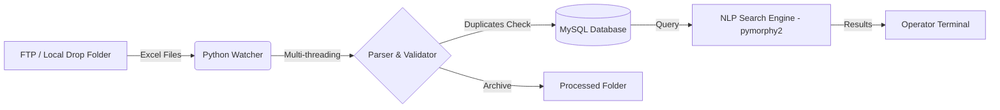

# Pharmacy Data Ingestion & Search Service

A production-ready ETL service designed to automate the ingestion, validation, and searching of pharmacy data.

## Business Context
Manual data entry from legacy Excel reports is prone to errors and slows down operations. This service automates the end-to-end pipeline: from monitoring a secure folder for incoming files to parsing, deduplicating, loading into a MySQL database, and providing a fast NLP-based search engine for internal operators.

## Architecture


## Features
- **Fault-Tolerant Ingestion:** Multi-threaded file processing (`ThreadPoolExecutor`) ensuring that one corrupted file does not halt the pipeline.
- **Data Quality:** Built-in deduplication checks, type casting, and handling of empty values.
- **Audit Trail:** Full logging of file processing statuses directly into the database.
- **Smart Search (NLP):** Integration of `pymorphy2` for Russian lemmatization and stop-word filtering, allowing operators to search using natural language (e.g., "аптеки на Ленина").
- **Docker Support:** Fully containerized environment for seamless deployment.

## Tech Stack
`Python` · `Pandas` · `MySQL` · `pymorphy2` · `concurrent.futures` · `Docker` · `Logging`

## Quick Start (Local)

1. Install dependencies:
   ```bash
   pip install -r requirements.txt
   ```

2. Copy the environment template and fill in your database credentials:
   ```bash
   cp .env.example .env
   ```

3. Initialize the database and start the ETL watcher:
   ```bash
   python src/main.py
   ```

4. To launch the interactive search module:
   ```bash
   python src/search_main.py
   ```